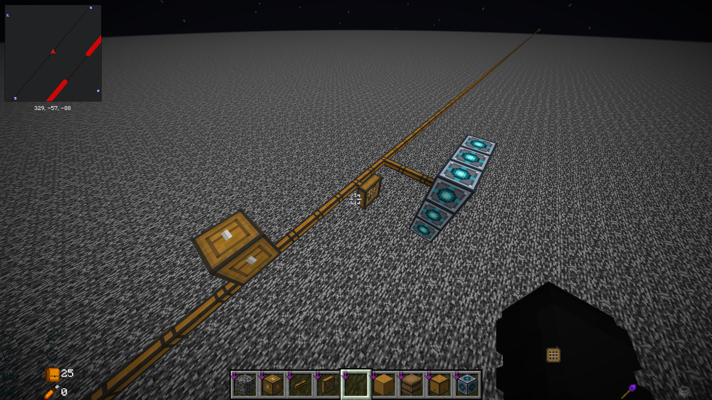
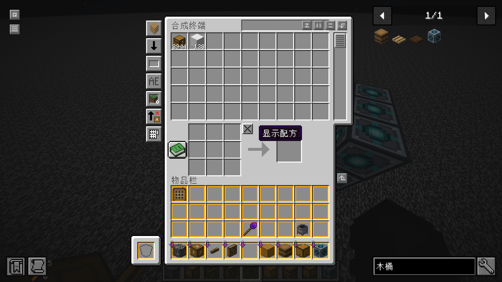

# Tom's Virtual Storage Network

为 Tom's Simple Storage 增加虚拟木桶仓库，并让已经登记的存储线缆在中间区块卸载后继续参与网络连接。

适用于 **Minecraft 26.3 / Fabric**。客户端和服务端都需要安装。

[下载 1.0.0](https://github.com/YMXKNebula/toms-virtual-storage-network/releases/tag/v1.0.0) · [使用说明](docs/usage.md) · [反馈问题](https://github.com/YMXKNebula/toms-virtual-storage-network/issues)



游戏内的虚拟木桶、连接器、线缆和终端。截图来自开发期间的测试世界，画面中的小地图及信息提示由其他模组提供。

## 能做什么

- 每个 Tom 的木桶提供 **64 格**存储空间。同种物品可以占多格，每格上限跟随游戏当前的堆叠设置。
- 名称、附魔、药水等物品数据分别保存，不把不同物品变体混在一起。
- 相邻木桶组成仓库，经存储连接器接入 Tom's Storage 网络；同一仓库可以连接多个连接器。
- 已登记并验证连通的线路和虚拟仓库可以跨越卸载区块。终端仍由网络中已加载的可用连接器提供存取入口。
- 木桶没有独立容器或逐桶运行的方块实体，适合集中扩容。它不能右键打开，也不能让漏斗或机器直接存取。
- 库存及线路随世界保存；断线撤销访问权限，物品保留。拆除木桶时优先转存，剩余物品分批掉落。



保留原模组的终端操作方式。截图中的物品数量只是测试世界的库存示例。

## 安装

| 依赖 | 版本 |
| --- | --- |
| Minecraft | 26.3 |
| Java | 25 或以上 |
| Fabric Loader | 0.19.5 或以上 |
| Fabric API | 适用于 26.3，0.165.0+26.3 或以上 |
| Tom's Simple Storage | **2.12.2** |

下载 Release 中的 `toms-virtual-storage-network-26.3-1.0.0.jar`，放入客户端和服务端的 `mods` 文件夹。单人游戏只需要放入客户端。

更新前正常退出游戏或停止服务器，备份完整世界，再替换旧 TVSN。安装本模组时移出旧的 **Tom's Persistent Cables** 和 **Tom's Event Optimizer**，保留 Tom's Storage 本体。不要同时安装多个版本；`-sources.jar` 是开发用源码，不放入 `mods`。

本模组不依赖曲率漏斗补充包。如需批量转运，可另装 [Tom's Storage Additions](https://github.com/YMXKNebula/toms-storage-additions)。

## 开始使用

在工作台合成一个 Tom 的木桶：

| 铁锭 | 末影珍珠 | 铁锭 |
| --- | --- | --- |
| 末影珍珠 | 原版木桶 | 末影珍珠 |
| 铁锭 | 末影珍珠 | 铁锭 |

将木桶贴在一起，再放置一个 Tom's Storage 存储连接器连接仓库。末影核心变亮表示已激活；没有接通连接器时为深青色。大仓库的外观会分批更新。

```text
终端 — 存储线缆 — 存储连接器 — 相邻虚拟木桶
```

终端可以直接接在线缆上。只要通过有效线路能到达至少一个已加载的可用连接器，无论连接器是否紧贴仓库，都可以提供入口；所有可用连接器卸载后停止存取。普通箱子等外部容器仍需要加载，双箱需要两半都加载。

## 使用前了解

- 当前只支持同一维度内的仓库网络，尚不支持跨维度虚拟仓储。
- 没有强制加载区块。未登记的线路需要先实际加载并完成验证。
- 极端复杂网络尚未实现磁盘分页。大规模建造、集中存取和世界保存仍可能造成停顿。
- 世界备份需要包含区块、实体、玩家数据和 `data`。不要只恢复账本文件或只恢复区块。
- 异常退出后库存可能进入保护隔离，处理方式见[存档与恢复](docs/usage.md#存档与恢复)。

堆叠上限调整、拆桶转存、离线仓库存取和连接器重载均有自动化测试；这不代表所有第三方机器及整合包组合都已验证。具体范围见[验证记录](docs/testing.md)。

## 开发

源码采用 MIT 许可。[构建与测试](docs/development.md)包含依赖准备、测试命令和项目结构。

本项目是独立附属模组，与 Tom's Simple Storage 原作者及 Mojang 无隶属关系。[第三方资源说明](THIRD_PARTY_NOTICES.md)。
