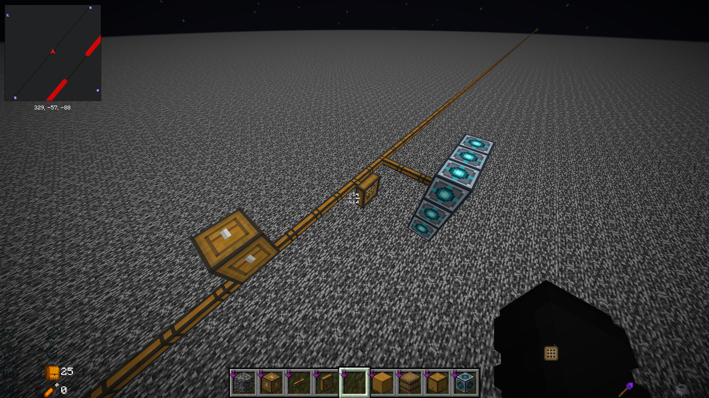

适用于 **Minecraft 26.3 / Fabric / Tom's Simple Storage 2.12.2**。

## 主要功能

- 新增 Tom 的木桶：每桶 64 格，物品堆叠上限跟随游戏设置，同种物品可占多格。
- 相邻木桶组成仓库，经连接器接入 Tom's Storage 终端和传输网络。
- 保存已登记的线缆连接关系，支持通过已加载连接器访问已验证的离线虚拟仓库。
- 保留直接终端数量修复、双箱识别、拆桶优先转存与持久化待处理任务。
- 包含连接器区块重载后的入口缓存修复，不需要曲率漏斗补充包来提供这项修复。

木桶只能通过连接器存取，不能直接接漏斗或机器。所有可用连接器卸载后停止访问。当前不支持跨维度虚拟仓储，也未实现极端复杂网络的磁盘分页。

## 安装与更新

客户端和服务端都安装 `toms-virtual-storage-network-26.3-1.0.0.jar`。

需要 Java 25 或以上、Fabric Loader 0.19.5 或以上、适用于 26.3 的 Fabric API 0.165.0+26.3 或以上，以及 Tom's Storage **2.12.2**。

更新前正常停服并备份完整世界，替换旧 TVSN。移出旧 Tom's Persistent Cables 和 Tom's Event Optimizer，保留 Tom's Storage 本体。已有 TVSN 0.2.2-dev 木桶的 ID、容量与账本格式保持兼容。

`-sources.jar` 用于开发，不放进 `mods`。`SHA256SUMS.txt` 用于核对下载文件。完整源码、合成方式及接线说明见[项目主页](https://github.com/YMXKNebula/toms-virtual-storage-network/tree/v1.0.0)。

这是首次公开版本。已通过核心、服务器及与曲率漏斗的组合测试，详情见[验证范围](https://github.com/YMXKNebula/toms-virtual-storage-network/blob/v1.0.0/docs/testing.md)。历史大规模测试没有在本版重跑，不作为 TPS 保证。
